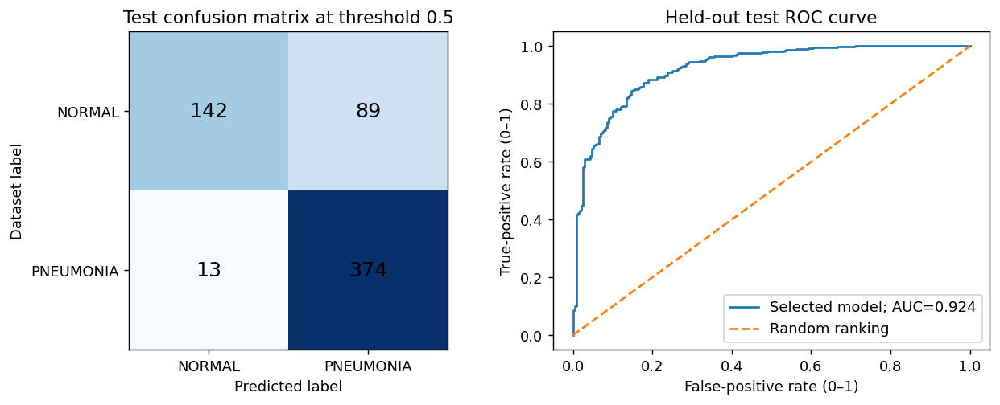

# Chest X-Ray Pneumonia Classification

An end-to-end Phase 1 classification project using interpretable image features and machine learning implemented from scratch.

**[View the notebook](Notebooks/Chest%20X-Rays%20Pneumonia.ipynb)** · **[Open the Colab copy](https://colab.research.google.com/drive/1YYoOyMphKF56mTT9NHhXdePRvVKolE9e)**

`Chest X-Rays Pneumonia.ipynb` is the only notebook in this repository. It contains the literature review, dataset audit, exploratory analysis, feature engineering, scaling, model training, validation, saved outputs and explanation guide. It is self-contained and does not require imports from this repository.

## Method

- Decode and audit the NORMAL/PNEUMONIA chest radiographs, checking duplicates and filename-derived patient groups.
- Remove development images linked to test groups and retain unique images.
- Extract 149 interpretable image features, including regional brightness and contrast summaries.
- Fit scaling on the training portion of each fold and compare a majority baseline, Gaussian Naive Bayes and regularized logistic regression using three grouped development folds.
- Select the model using development balanced accuracy, then evaluate the held-out test at the fixed 0.5 threshold.

Model fitting, gradient descent, scaling, fold assignment, metrics, ROC-AUC and bootstrap intervals are implemented explicitly. NumPy provides arithmetic, Pillow reads/resizes images, and Matplotlib produces plots. No scikit-learn or deep-learning framework is used.

## Saved results

The selected logistic regression model uses regularization `0.01`. The saved local run retained 4,753 development images and 618 test images.

- Mean development CV balanced accuracy: **95.38%**
- Test accuracy: **83.50%**
- Test balanced accuracy: **79.06%**
- Pneumonia recall: **96.64%**
- Specificity: **61.47%**
- F1 score: **0.8800**
- ROC-AUC: **0.9240**
- Confusion counts: 142 true negatives, 89 false positives, 13 false negatives and 374 true positives.

See [the saved evaluation](basic_phase1/final_results.json), [model comparison](basic_phase1/model_comparison_cv.csv), and [test predictions](basic_phase1/test_predictions.csv). Notebook outputs were executed locally; a Colab training run is not claimed.



## Repository contents

```text
Notebooks/
  Chest X-Rays Pneumonia.ipynb   Complete executed project notebook
basic_phase1/                   Audit, folds, model comparison, predictions and parameters
  figures/                      Figures generated by this notebook
src/basic_ml.py                 Matching implementation used by verification
verify_basic.py                 Math, notebook and saved-artifact checks
requirements.txt               Notebook dependencies
```

## Run in Google Colab

Open the Colab link above, select a CPU runtime and run all cells. The notebook checks for the dataset and attempts to download the public Kaggle archive if needed. If the download is unavailable, upload and extract the archive under `/content/data/chest_xray`, then rerun. Outputs are written to `/content/basic_phase1`.

## Run locally

Use Python 3.12. Download and extract the [Kaggle Chest X-Ray Images (Pneumonia) dataset](https://www.kaggle.com/datasets/paultimothymooney/chest-xray-pneumonia) so that `~/Downloads/chest_xray` contains `train`, `val` and `test`, each with `NORMAL` and `PNEUMONIA` folders.

```bash
python3 -m venv .venv
source .venv/bin/activate
python -m pip install -r requirements.txt
```

Open `Notebooks/Chest X-Rays Pneumonia.ipynb` in a notebook editor such as VS Code or Jupyter (installed separately), choose this environment and run all cells. The notebook handles execution from the repository root or `Notebooks/`. Results are written to `basic_phase1/`.

After running the notebook, verify the math, saved outputs, group isolation, scaler and reloaded model parameters:

```bash
python verify_basic.py
```

The full verification requires `basic_phase1/basic_features.npz`, generated by running the notebook and excluded from Git. The saved notebook outputs and figures can be viewed without downloading the dataset or rerunning training.

## Limitations

This is an educational benchmark, not a clinical diagnostic tool. Filename/hash grouping is a proxy and does not establish verified patient independence. The CV-to-test performance gap and modest specificity limit generalization. The literature review and methodological rationale are included in the notebook.

Raw images, temporary archives, generated feature caches, LaTeX reports and presentations are excluded from Git.
